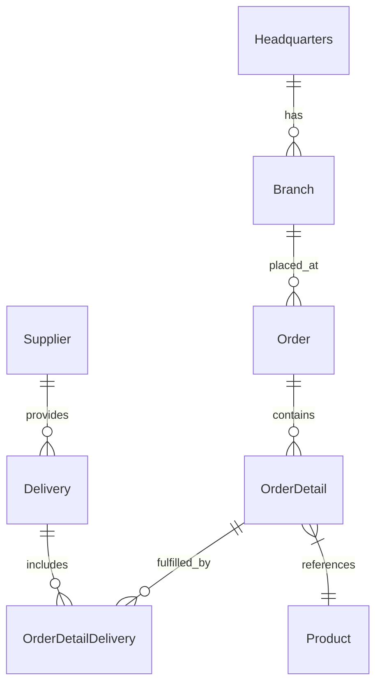
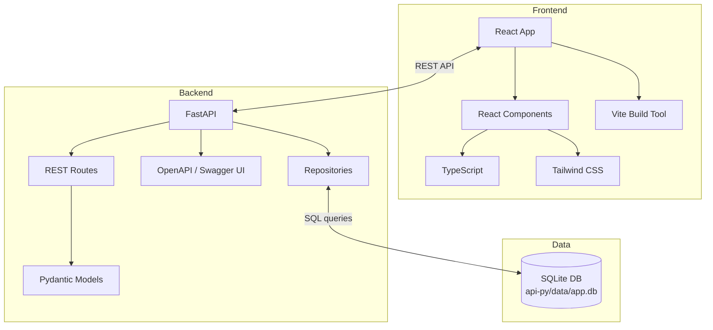

# OctoCAT Supply Chain Management System Architecture

This application is a demo full-stack supply chain management app. The backend API was built with **Python/FastAPI** and the frontend with React + Vite + Tailwind. All UI components and API routes were developed with GitHub Copilot assistance.

The hero image and product images were created by prompting ChatGPT.

## Architecture Overview

The system comprises:
- A **Python FastAPI** backend serving a RESTful API over a shared SQLite database
- A **React + Vite + Tailwind** frontend consuming the API

### Backend Architecture
- FastAPI REST API with routes for all supply chain entities
- SQLite persistence using a lightweight repository pattern (`src/api-py/repositories/`)
- Schema migrations and seed data managed via SQL files in `src/database/`
- Pydantic models for request/response validation and OpenAPI documentation (auto-generated at `/docs`)

### Frontend Architecture
- React 18+ with TypeScript
- Vite build tool for fast development
- Tailwind CSS for UI styling

### DevOps Integration
- Docker for containerization of both API and frontend
- Bicep + GitHub Actions pipeline for Azure deployment (Challenge 5)

## ERD

## Component Architecture

## Key Features

- Complete REST APIs for all supply chain entities
- SQLite-backed persistence with foreign keys and indexed queries
- Declarative migrations (`src/database/migrations/`) and deterministic seed data (`src/database/seed/`)
- Auto-generated OpenAPI documentation via FastAPI
- Modern React UI with responsive design
- Containerization for consistent deployment

## Persistence and Data Model

- **Database**: SQLite (file located at `api-py/data/app.db` by default; configurable via `DB_FILE`)
- **Access**: thin repository layer in `src/api-py/repositories/` using Python's `sqlite3` module with parameterized queries
- **Migrations**: SQL scripts in `src/database/migrations/` executed in order on startup and tracked in a `migrations` table
- **Seeding**: ordered SQL scripts in `src/database/seed/` to bootstrap demo data
- **Test mode**: in-memory database (`:memory:`) for fast and isolated tests

See the dedicated guide: `sqlite-integration.md`.
